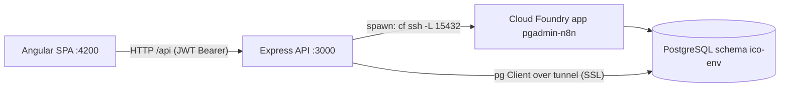
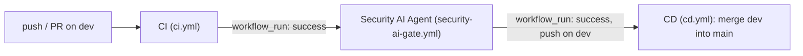

# Desk Reservation App – Project Overview

A web application for reserving office desks. Employees register, sign in, pick a date and a desk on an office map and book it. Admins manage all bookings. The repo also contains an AI-based security-review agent that runs in the Azure DevOps release pipeline.

---

## 1. Repository layout

```
.
├── Backend/                    Node.js + Express 5 + TypeScript REST API
│   ├── src/                    Application code (see §3)
│   ├── tests/unit/             node:test unit tests (jwt, password utils)
│   ├── security-ai-agent/      LangChain security-report agent (see §8)
│   ├── query.ts                Read-only SQL CLI for the DB (npm run query)
│   ├── write-ca.ts             Fetches DB CA cert from Cloud Foundry (npm run ca)
│   ├── Containerfile, compose.yaml, entrypoint.sh
├── Frontend/                   Angular 18 SPA (NgModule-based) + PrimeNG
│   ├── src/app/                core/, features/, shared/ (see §4)
│   ├── nginx.conf              Reverse proxy /api -> backend:3000 + SPA fallback
│   ├── Containerfile, compose.yaml, entrypoint.sh
├── hmm/ai-agents/              Minimal LangChain "hello world" against the LLM Farm (sandbox)
├── .github/workflows/         GitHub Actions: ci, security-ai-gate, cd, container-images (disabled)
├── compose.yaml                Runs backend + frontend together
├── azure-pipelines.yml         CI: publishes artifacts (branch `dev`)
├── azure-release-pipeline.yml  CD: audits dependencies + runs AI security agent
└── forward-ports.ps1           Windows helper: forwards Podman/WSL2 ports to localhost
```

---

## 2. Architecture



- Frontend talks only to `/api/auth/*` and `/api/` (booking command endpoint).
- Backend is layered: **routes → controllers → services → repositories → DB**.
- The database is a Bosch-internal PostgreSQL reachable only through a Cloud Foundry SSH tunnel (`cf ssh`). The backend opens/closes this tunnel itself.

---

## 3. Backend

### 3.1 Tech stack
Node.js, TypeScript (ESM, `module: nodenext`, `.ts` import extensions, `erasableSyntaxOnly`), Express 5, `pg`, `jsonwebtoken`, `bcrypt`, `express-rate-limit`, `cors`, `morgan`, `dotenv`, `tree-kill`, `tsx` (runtime/test runner), `c8` (coverage).

### 3.2 Scripts (`Backend/package.json`)

| Script | Purpose |
| --- | --- |
| `npm start` | `node src/server.ts` (native TS type-stripping) |
| `npm run build` | `tsc` -> `dist/` |
| `npm test` / `npm run test:coverage` | `tsx --test tests/unit/*.test.ts` (optionally via `c8`) |
| `npm run ca` | `write-ca.ts`: reads DB service key via `cf service-key` and writes `rb-ca.crt` |
| `npm run tunnel` | Manual `cf ssh` tunnel |
| `npm run query "<SELECT …>"` | Read-only query tool (rejects non-SELECT/WITH/EXPLAIN/SHOW/TABLE and multi-statements) |

The container (`entrypoint.sh`) runs `npx tsx src/server.ts`.

### 3.3 Configuration (`src/config/config.ts`, `db.ts`)

| Env var | Default | Use |
| --- | --- | --- |
| `PORT` | `3000` | HTTP port |
| `CORS_ORIGIN` | `http://localhost:4200` | Allowed origin |
| `JWT_SECRET` | hard-coded fallback | JWT signing |
| `JWT_EXPIRES_IN` | `1d` | Token lifetime |
| `ENABLE_TUNNEL` | – | `true` opens a CF tunnel on startup (compose sets `false`) |
| `PGHOST` / `PGPORT` | `127.0.0.1` / `15432` | DB host / local tunnel port |
| `PGDATABASE`, `PGUSER`, `PGPASSWORD` | – | DB credentials |
| `PGCA`, `PGSERVERNAME` | – | If `PGCA` file exists: strict TLS verification with that CA and SNI name; otherwise `rejectUnauthorized: false` |

### 3.4 Startup sequence (`src/server.ts`)
1. `createApp()` builds Express app (CORS, JSON body parser, Morgan `dev`, routes, error handler).
2. Optionally opens DB tunnel (`ENABLE_TUNNEL=true`).
3. `seedAdminUser()` creates the default admin if missing.
4. `cleanupPastBookings()` runs once, then every 24 h (deletes bookings with `booking_date < CURRENT_DATE`).
5. Listens on `PORT`.

### 3.5 Database

Schema `"ico-env"`. Tables as documented in `Backend/README.md`:

**`users`**

| Column | Type | Notes |
| --- | --- | --- |
| `id` | SERIAL PK | |
| `full_name` | VARCHAR(255) | |
| `email` | VARCHAR(255) UNIQUE | login identifier |
| `password_hash` | TEXT | bcrypt (10 rounds) |
| `secret_key` | TEXT | user-chosen recovery key (stored as plain text) |
| `temp_password_hash` | TEXT NULL | bcrypt hash of an active temporary password |
| `type` | VARCHAR(10) | `CHECK IN ('admin','user')` |
| `created_at` | TIMESTAMPTZ | default `NOW()` |

**`bookings`**

| Column | Type | Notes |
| --- | --- | --- |
| `id` | SERIAL PK | |
| `user_name` | VARCHAR(255) | the user's **full name** (not a FK) |
| `booking_date` | DATE | |
| `booking_desk` | VARCHAR(100) | e.g. `A1`…`D4` |
| `created_at` | TIMESTAMPTZ | |
| – | `UNIQUE (booking_date, booking_desk)` | one booking per desk per day |

Data access (`runQuery` in `db.ts`) opens a **new `pg.Client` per query** and closes it afterwards. Repositories wrap every call in `withTunnel()`, which serialises requests through a promise chain and opens/closes the CF tunnel around each query.

### 3.6 API

All responses use `{ success: boolean, payload?, message?, errors? }`.

| Method & path | Auth | Rate limit | Description |
| --- | --- | --- | --- |
| `POST /api/auth/register` | – | 10 / 15 min | Body `fullName, email, password, secretKey`. Role is always `user`. `409` if email exists. |
| `POST /api/auth/login` | – | 10 / 15 min | Returns `id, fullName, email, type, token, isTempPassword`. `401` on bad credentials. |
| `POST /api/auth/reset-password` | – | 10 / 15 min | Body `email, newPassword`. Sets a new password and clears any temp password. `404` if unknown email. |
| `POST /api/auth/temp-password` | – | 10 / 15 min | Body `email, secretKey`. Returns a 12-character temporary password if the secret key matches. |
| `GET /api/auth/users` | JWT + admin | 10 / 15 min | Lists users (`id, fullName, email, type`). |
| `POST /api/` | JWT | 30 / 15 min | Single "command" endpoint for bookings (below). |

**Booking command endpoint** – body:
```json
{ "table_name": "BOOKINGS_TABLE", "operation": "READ|CREATE|UPDATE|DELETE", "data": { "id": 1, "user_name": "…", "booking_date": "…", "booking_desk": "A1" } }
```
- `READ`: all bookings ordered by date, desk.
- `CREATE`: requires `user_name`, `booking_date`, `booking_desk`.
- `UPDATE`: requires `id`; partial update via SQL `COALESCE`.
- `DELETE`: requires `id`; returns `{ id }`.
- Validation failure -> `400` with `errors[]`; missing row -> `404`; Postgres unique violation (`23505`) -> `409 "This desk is already booked for this date"`.

### 3.7 Middleware
- `auth.middleware.ts`: expects `Authorization: Bearer <jwt>`, verifies it, sets `req.user` (typed via global Express augmentation). `401` otherwise.
- `admin.middleware.ts`: requires `req.user.type === 'admin'` else `403`.
- `rateLimit.middleware.ts`: `authRateLimiter` (10/15 min), `bookingRateLimiter` (30/15 min).
- `error.middleware.ts`: final handler returning `{ success:false, message }` with `err.status || 500`.

### 3.8 Authentication & business logic (`AuthService`)
- **Register**: reject duplicate email -> bcrypt-hash password -> insert as `user`.
- **Login**: lookup by email. If a **temporary password** exists, *only* it is accepted; on success it is cleared and `isTempPassword: true` is returned so the UI forces a password reset. Otherwise the regular password is compared. A JWT (`id`, `email`, `type`) is issued; `fullName` is intentionally not in the token.
- **Forgot password flow**: user supplies email + secret key -> server generates a 12-char temp password (`A-Za-z0-9!@#$%^&*`) -> stores its bcrypt hash -> returns it in the response -> user logs in with it -> is redirected to reset-password.
- **Reset password**: updates `password_hash` and nulls `temp_password_hash`.
- **Admin seeding**: `admin@gmail.com` is created on startup if absent (see §9).

### 3.9 Tests
`Backend/tests/unit`: `jwt.utils.unit.test.ts` (round-trip, invalid token, `fullName` not encoded) and `password.utils.unit.test.ts` (length 12, allowed charset). Services, controllers and repositories are not covered.

---

## 4. Frontend

### 4.1 Tech stack
Angular 18 (NgModule architecture, not standalone), TypeScript 5.4, RxJS 7.8, PrimeNG 18 (`DatePicker`, Aura theme), Font Awesome icons, Karma/Jasmine. Plain CSS per component. Dev server on port 4200.

### 4.2 Environments
- `environment.ts`: `apiUrl: 'http://localhost:3000/api'`
- `environment.production.ts`: `apiUrl: '/api'` (to be served behind the nginx proxy)
- Both define `CURRENT_USER_STORAGE = 'currentUser'` (localStorage key).

### 4.3 Folder structure (`src/app`)
- `core/` – singletons: `services/` (`AuthService`, `BookingService`), `guards/`, `interceptors/`, `models/`, `auth/` (sign-in, register, reset-pass, temp-pass pages).
- `features/` – routed pages: `booking`, `information`, `admin-dashboard`, `not-found`.
- `shared/` – `SharedModule` exporting reusable components (`header`, `top-bar`, `calendar`, `map`, `table`, `action-button`, `error-notification`) and layout wrappers (`ui-wrappers/`: `shadow-box`, `main-div`, `auth-div`).

### 4.4 Routes (`app-routes.ts`)

| Path | Component | Guard | Header / top bar |
| --- | --- | --- | --- |
| `` | redirect -> `login` | – | – |
| `login`, `register`, `temp-pass`, `reset-pass` | auth pages | – | header hidden |
| `booking` | `BookingComponent` (calendar + map + top bar) | `AuthGuard` | header |
| `info` | `InformationComponent` (day's booking table + map) | `AuthGuard` | header |
| `admin` | `AdminDashboardComponent` | `AdminGuard` | header, top bar hidden |
| `**` | `NotFoundComponent` | – | header hidden |

`AppComponent` reads `showHeader` / `showTopbar` from the deepest activated route's `data` on each `NavigationEnd`.

### 4.5 Features

**Authentication pages**
- *Sign in*: reactive form (email, required password), show/hide password, links to register / forgot password. If the response has `isTempPassword`, navigates to `/reset-pass`, otherwise `/booking`.
- *Register*: full name, email, password, confirm password, secret key. Password and secret key: 6–10 chars, at least one uppercase letter, one digit and one special character; passwords must match.
- *Temp password* (forgot password): email + secret key -> shows generated temporary password with copy-to-clipboard button.
- *Reset password*: new password + confirm (same rules); requires a logged-in user, otherwise redirected to login; cancel logs out.

**Booking page**
- `CalendarComponent` (inline PrimeNG date picker): weekends disabled, past days disabled, can only select up to **3 working days ahead** (`calculateLimitDays` skips Sat/Sun). Violations publish a `ValidationStatus` and show a warning.
- `MapComponent`: 4 groups (A–D) × 4 desks (1–4) = 16 desks. Status per desk for the selected date: `available`, `selected`, `booked` (by someone else), `mine`. If no date or the date is invalid, all desks show as `booked` (not selectable). Clicking toggles selection.
- `TopBarComponent`: shows the current selection, and a single button that is **"Book Now"** or **"Withdraw booking"** depending on whether the current user already has a booking that day. Enforces **one booking per user per day** (client-side). Errors shown through `ErrorNotificationComponent` for 3 s.

**Information page**: table of all bookings for the selected date (user, desk) and the map.

**Admin dashboard** (admin only; also a link in the header when `type === 'admin'`):
- Table of all bookings sorted by date with Edit / Delete.
- Modal for create/edit: user (datalist populated from `GET /auth/users`), office group, desk number, date.
- Client-side rules: no weekends; no desk/date collisions; one operation at a time (loading flags disable actions).
- Uses Angular **signals** for state (the only component that does).

**Header**: app title link, admin link, user name, sign-out icon (door icon animates on hover).

### 4.6 State & data flow
- `AuthService`: `BehaviorSubject<UserRecord|null>` (`currentUser$`), hydrated from `localStorage` at construction; `login` stores `{fullName,email,type,token}`; `logout` clears it. `isTokenValid` only checks that a token exists (no expiry check).
- `AuthTokenInterceptor` (class-based, registered via `HTTP_INTERCEPTORS`): reads token from `localStorage` and adds `Authorization: Bearer`.
- `BookingService` is the central store: subjects for `bookings`, `selectedDesk`, `selectedDate`, `user`, `validation`, and a `notifications` stream. Components subscribe and update local fields. Maps API rows (`user_name`, `booking_desk`, `booking_date`) to the `Booking` model (`user`, `deskId`, `date`). All booking calls go through `execute(command)` -> `POST {apiUrl}/`.
- Guards (`AuthGuard`, `AdminGuard`) are class-based `CanActivate`; they redirect to `/login` or `/booking`.

### 4.7 Tests
Only `admin-dashboard.component.spec.ts` has real tests (~35 cases: init, create/edit/cancel, save validation, collisions, delete). Other `*.spec.ts` files are generated stubs.

---

## 5. End-to-end business flows

1. **Registration** -> user created with role `user`.
2. **Login** -> JWT stored in localStorage -> `/booking`.
3. **Book a desk** -> select weekday within next 3 working days -> select free desk -> "Book Now" -> `CREATE` command; unique constraint prevents double-booking (UI shows error).
4. **Withdraw** -> same page shows "Withdraw booking" for the user's booking on that day -> `DELETE`.
5. **Forgot password** -> email + secret key -> temp password -> login with it -> forced reset -> `/booking`.
6. **Admin** -> create/edit/delete any booking, assign bookings to any registered user.
7. **Housekeeping** -> past bookings are purged at startup and every 24 h.

---

## 6. Coding conventions

### Backend
- Layering: `routes -> controllers -> services -> repositories`; controllers are classes with `static async` methods; services and repositories are also static-method classes.
- File naming: `PascalCase` for classes (`AuthController.ts`), `kebab/dot` style for others (`auth.routes.ts`, `jwt.utils.ts`, `rateLimit.middleware.ts`, `auth.validator.ts`, `booking.types.ts`).
- ESM with explicit `.ts` import extensions; `import type` for types (`verbatimModuleSyntax`).
- Double quotes, semicolons, trailing commas, 2-space indent (Prettier-style defaults).
- Hand-written validators return `{ valid, errors[] }`; controllers respond `400` with `errors`.
- Uniform JSON envelope `{ success, payload | message }`.
- SQL is parameterised (`$1…`) and uses the quoted schema `"ico-env"`; DB columns are `snake_case`, API/auth payloads use `camelCase` (except the booking payload, which keeps `snake_case`).
- Errors: `try/catch` in controllers with `console.error`; status mapping by checking `error.message` text or Postgres error code.
- Tests: Node built-in `node:test` + `node:assert/strict`, named `*.unit.test.ts`.

### Frontend
- `.editorconfig`: UTF-8, 2 spaces, final newline, **single quotes in `.ts`**.
- Angular file naming: `name.component.{ts,html,css,spec.ts}`, `name.service.ts`, `name.guard.ts`, `name.interceptor.ts`; selectors prefixed `app-`.
- One folder per component; styles in separate CSS files (`styleUrl`).
- Reactive forms for auth pages, template-driven `ngModel` for the admin modal.
- Subscriptions in components use a `destroy$` subject + `takeUntil` in `ngOnDestroy`.
- Buttons are configured through the `ActionConfig` object (`label`, `loadingLabel`, `variant`, `disabled`) and a getter that merges loading/validity state.
- Shared building blocks (`shadow-box`, `main-div`, `auth-div`) wrap content for consistent layout.
- Models are plain interfaces in `core/models`.

### General
- Containers use `Containerfile` (Podman-oriented); proxies passed as build args and unset at runtime.
- Comments are short, explaining intent.

---

## 7. Build, run & deploy

**Local (npm)**
```bash
# Backend
cd Backend && npm install && npm start        # needs .env (see §3.3); cf CLI logged in if tunnel is used
# Frontend
cd Frontend && npm install && npm start       # http://localhost:4200
```

**Containers** – `compose.yaml` at repo root builds both images (Node 18-slim), mounts `src/` for live reload, exposes `3000` and `4200`. Root compose sets `ENABLE_TUNNEL=false`. The frontend container runs `ng serve` (polling watch for WSL2). `forward-ports.ps1` forwards ports 4200/3000 from the Podman WSL2 VM to Windows localhost.

**GitHub Actions (`.github/workflows`)**



| Workflow | Trigger | What it does |
| --- | --- | --- |
| `ci.yml` (**CI**) | push / PR on `dev` | Job `backend-build` (Ubuntu, Node 18): `npm ci`, `npm run test:coverage`, `npm run build`, uploads `backend-build` artifact (`dist`, `package*.json`). The frontend job (`npm ci`, Karma tests in ChromeHeadless, build, artifact) is **commented out**. |
| `security-ai-gate.yml` (**Security AI Agent**) | `workflow_run` of CI, only if CI succeeded and the head repo is this repo | Checks out the CI head SHA (Node 20); installs Frontend, Backend and agent dependencies; creates `npm audit --json` reports for both apps; creates a `git diff` of `package.json`/`package-lock.json` files; runs **CodeQL** (`javascript-typescript`, SARIF output normalised to `codeql.sarif`); runs the AI agent; uploads `ai-security-artifacts`; writes the report to the job summary; posts/updates a PR comment (marker `<!-- ai-security-agent -->`); final step fails the job if the agent exit code is not `0`. Missing `GENAIPLATFORM_FARM_SUBSCRIPTION_KEY`, or a proxy pointing to localhost, produces a **BLOCK** report with exit codes `2` / `3`. Secrets used: `GENAIPLATFORM_FARM_SUBSCRIPTION_KEY`, `HTTP_PROXY`, `HTTPS_PROXY`. Permissions: `contents: read`, `pull-requests: write`, `security-events: write`. |
| `cd.yml` (**CD**) | `workflow_run` of a workflow named `Security AI Gate` | If it succeeded for a direct **push** on `dev` (never PR runs), merges `origin/dev` into `main` (`--no-ff`) and pushes with `GITHUB_TOKEN` (`contents: write`). |
| `container-images.yml` | – | Entirely **commented out**. Intended: on push to `main`, build frontend/backend images with Podman and push to `ghcr.io/<owner>/desk-reservation-{frontend,backend}` tagged `<sha>` and `latest`. |

**Pipelines (Azure DevOps)**
- `azure-pipelines.yml` (trigger and PR on `dev`, `windows-latest`): publishes three artifacts – `drop` (security agent), `backend-app`, `frontend-app`.
- `azure-release-pipeline.yml` (manual, deployment job on environment `CLJVM00485`): downloads the artifacts, configures the Bosch Artifactory npm registry, runs `npm ci` + `npm audit --json` for backend and frontend, builds `dependency-changes.txt`, runs the AI agent, and publishes `ai-security-reports`.

---

## 8. AI agents

**`Backend/security-ai-agent`** (ESM, LangChain `AzureChatOpenAI`):
- Reads `backend-audit.json`, `frontend-audit.json`, `codeql.sarif`, `dependency-changes.txt` from `--reports-dir` / `SECURITY_REPORTS_DIR` (default `./reports`).
- Sends them to the Bosch LLM Farm (`https://aoai-farm.bosch-temp.com/api`, deployment `gpt-5-nano-2025-08-07`) with a system prompt asking for: risk assessment with **ALLOW/BLOCK** recommendation, urgent findings, attack chains, prioritized remediation.
- Writes `ai-security-report.md` and `ai-security-summary.json`.
- Auth via header `genaiplatform-farm-subscription-key` (`GENAIPLATFORM_FARM_SUBSCRIPTION_KEY`); corporate proxy support through `undici` `ProxyAgent` (`HTTPS_PROXY`/`HTTP_PROXY`); prints connection diagnostics on failure.
- Structure: `index.js` -> `src/main.js` (orchestration), `args.js`, `files.js`, `llm.js`.
- The committed sample report shows a BLOCK result because no scan inputs were present.
- Runs in two places: the GitHub `security-ai-gate.yml` workflow (with CodeQL data) and the Azure release pipeline (without CodeQL).
- The agent only ever exits `0` after a successful LLM call; it does not parse the ALLOW/BLOCK text, so the GitHub gate blocks only on missing key, proxy problems or agent failure.

**`hmm/ai-agents`**: a standalone smoke test (English -> French translation) of the same LLM connection.

---

## 9. Known issues & risks observed during analysis

Security
1. `POST /api/auth/reset-password` is unauthenticated and takes only `email` + `newPassword` – anyone can reset any account's password. It should require the JWT (use `req.user.email`).
2. Any authenticated user can `CREATE`/`UPDATE`/`DELETE` **any** booking via `POST /api/`; role and ownership are not checked server-side, and `user_name` is taken from the client. Admin-only operations are enforced only in the UI.
3. Hard-coded fallback `JWT_SECRET` in `config.ts`; fail startup if the env var is missing.
4. Default admin `admin@gmail.com` / `Admin12!` (password and secret key) is seeded on every fresh DB.
5. `secret_key` is stored and compared in plain text and works as a password-equivalent; `/temp-password` returns the temp password directly in the API response; temp password uses `Math.random()` (use `crypto.randomInt`).
6. Server-side validation is weak: no email format, no password policy (only enforced in the Angular form), no date format/weekend/3-day-window checks.
7. JWT stored in `localStorage`; client `isTokenValid` doesn't check expiry; no 401 handling/auto-logout.
8. TLS verification is disabled unless `PGCA` is configured.
9. Rate-limit responses omit the `success` field (inconsistent with the rest of the API).

Correctness / design
10. Business rules (one booking per user per day, 3-working-day window, no weekends, collisions) are mostly client-side; the DB only guarantees unique `(date, desk)`.
11. `user_name` (full name) is used as the booking key instead of a user id; two users with the same name collide, and renaming is not supported.
12. Dates are sent with `toLocaleDateString()` (locale-dependent format); consider ISO `YYYY-MM-DD`.
13. `Booking.id` is `string` in the frontend but `number` in the backend; the admin "create" passes `id: ''`.
14. A new DB connection and CF tunnel are opened/closed for **every query** (slow, serialised); use a pooled connection and keep the tunnel open.
15. Login errors on the client are all mapped to "Server Error: Please try again later.", hiding "Email or password is incorrect.".
16. `AuthController` determines HTTP status by matching error message text.
17. `GET /auth/users` is behind the strict auth rate limiter (10 / 15 min), which can throttle the admin dashboard.

Documentation / tooling drift
18. Root `README.md` is the Azure DevOps template. `Backend/README.md` (UTF-16 encoded) lists endpoints (`/bookings`, `/change-password`, …), env vars (`DATABASE_URL`, `DB_*`) and a `ts-node-dev` workflow that no longer match the code (`POST /api/` command endpoint, `PG*` vars, `tsx`). The AI-agent API version in that README (`2025-04-01-preview`) differs from the code (`2024-08-01-preview`).
19. `nginx.conf` (SPA + `/api` proxy) is not used by any Containerfile; production image does not exist yet (containers run `ng serve`).
20. `npm start` runs `node src/server.ts`, which needs native TypeScript type stripping (Node ≥ 22.6), while the container uses `node:18-slim` with `tsx`. `ts-node` and `ts-node-dev` are installed but unused.
21. `security-ai-agent/package.json` pins `undici` 6.21.3 while `hmm/ai-agents` uses `^7.29.0`.
22. The release pipeline generates only npm audit reports and a dependency snapshot; no `codeql.sarif` is produced, so the AI review has no CodeQL data.
23. `SharedModule` calls `RouterModule.forRoot(routes)` in addition to `AppModule` (should be `RouterModule` only).
24. Test coverage is minimal (2 backend util tests, 1 real frontend spec).

GitHub workflows
25. `cd.yml` waits for a workflow named `Security AI Gate`, but `security-ai-gate.yml` is named `Security AI Agent`; CD never triggers until the names match.
26. `security-ai-gate.yml` uses `Backend/ai-agents` (install, `npm ls undici`, run), but the agent lives in `Backend/security-ai-agent`; the workflow fails at the install step.
27. The AI gate does not enforce its ALLOW/BLOCK recommendation (see §8), so a `BLOCK` report can still let CD merge `dev` into `main`.
28. CI builds with Node 18 while the gate uses Node 20; the frontend build/tests are disabled in CI, so the Angular app is never built or tested there.
29. CD merges into `main` automatically with no review or approval, and `container-images.yml` is disabled, so no images are published from GitHub.
30. Two parallel CI/CD systems (GitHub Actions and Azure DevOps) both trigger on `dev` and run the same security agent.
