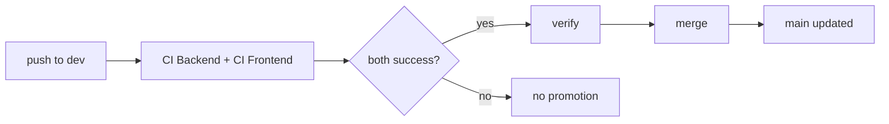

# Pipelines context

GitHub Actions, `cdMode: merge-only` (`.github/config.json` -> `pipelines`). Delivery means promoting code: a green CI run on `dev` is followed by a merge of that exact commit into `main`. Nothing is deployed, published, tagged or released.

## Workflows

| File | Name | Purpose |
| --- | --- | --- |
| `.github/workflows/ci-backend.yml` | `CI - Backend Test/Build` | Security check, build, test Backend; build the Backend image (no push) |
| `.github/workflows/ci-frontend.yml` | `CI - Frontend Test/Build` | Security check, build, test Frontend; build the Frontend image (no push) |
| `.github/workflows/ci-pr-check.yml` | `CI - PR Check` | PR hygiene: branches, title, description, forbidden files. Does not gate CD |
| `.github/workflows/cd.yml` | `CD - Merge dev into main` | Merge the `dev` commit that passed both area CI workflows into `main` (`--no-ff`) |

The agent-setup validation (`node scripts/check-agents.mjs`) is not a CI job: run it locally after changing skills, agents or `docs/agents/*.md`.

## CI (`ci-backend.yml`, `ci-frontend.yml`)

- Triggers: `push` to `dev`; `pull_request` into `dev` and `main`, both with `paths` filters: Backend runs only for `Backend/**` (or its own workflow file), Frontend only for `Frontend/**` (or its own workflow file). A change in one area does not start the other area's CI. Because a filtered workflow may not run, do not make these checks required on PRs (a required check that never runs stays pending); `CI - PR Check` has no filter and can be required.
- `permissions: contents: read`; concurrency per workflow and ref, `cancel-in-progress: true`.
- Jobs (no `continue-on-error`). The test job runs security check, build, test; the image job runs only after it:

| Workflow / job | Steps |
| --- | --- |
| Backend: `Backend - test and build` | in `Backend/`: `npm ci`, `npm audit --omit=dev --audit-level=critical`, `npm run build`, `npm test` (Node 22.18, npm cache) |
| Frontend: `Frontend - test and build` | in `Frontend/`: `npm ci`, `npm audit --omit=dev --audit-level=critical`, `npm run build`, `npm run test:ci` (Node 22.18, npm cache) |
| `<Area> - container image` (`needs` the test job) | `docker build -f <Area>/Containerfile <Area>`, local tag only; no push, login, `--build-arg`, proxy |

- Only `actions/checkout@v4` (`persist-credentials: false`) and `actions/setup-node@v4`. No secrets.

## CI - PR Check (`ci-pr-check.yml`)

- Trigger: `pull_request` (`opened`, `edited`, `synchronize`, `reopened`) into `dev` and `main`; job `PR - title, branches and files`, `contents: read`.
- Fails when: a PR into `main` is not from `dev`; a PR into `dev` is from `dev` or `main`; the title is not `<task-id>: <title>`; the description is under 20 characters; the diff against the base contains `.env`, `*.pem|key|crt|cer|pfx|p12` or `db-backups/`.
- Title, body and refs reach the shell only through `env:`; the merge commit is only inspected with git.

## CD (`cd.yml`)

- Triggers: `workflow_run` of `CI - Backend Test/Build` and `CI - Frontend Test/Build` (`completed`, branch `dev`); `workflow_dispatch` (no inputs).
- Automatic run proceeds only if the triggering CI run `conclusion == success`, `event == push` and `head_branch == dev` (PR runs and forks never promote).
- Workflow-level `permissions: contents: read`; concurrency group `cd-merge`, `cancel-in-progress: false`.

| Job | Permissions | What it does |
| --- | --- | --- |
| `verify` | `contents: read`, `actions: read` | Resolves the SHA: `workflow_run.head_sha`, or for a manual run the current head of `dev` (dispatch must be from `dev`). Checks it is a 40-char SHA, then confirms via the Actions API that both CI workflows are green for it and outputs `ready`: a successful `push` run for the SHA, or, if the workflow was skipped by its path filter, a successful latest completed `dev` run whose commit is an ancestor with no change in that area since. A skipped area with a red or missing baseline blocks promotion. The run triggered by the workflow that finishes last promotes, the other skips; a manual run fails if not ready. A push touching neither area (docs only) starts no CI and no CD; it is promoted with the next code push or by a manual dispatch. |
| `merge` (`needs: verify`, only if `ready`) | `contents: write` (only job) | Checks out `main` (full history), fetches `dev`, requires the SHA to be an ancestor of `origin/dev`, no-op if `main` already contains it, otherwise `git merge --no-ff <sha>`, then `git push origin HEAD:refs/heads/main`. |

- Merge commit message: `chore: merge dev into main (CI passed for <short-sha>)`; identity `github-actions[bot]`.
- Conflict: `git merge --abort`, job fails, nothing is pushed. Rejected push (main moved) fails the job; no force, no rebase, no reset, no retry.
- Push is by explicit refspec to `main` only: no other branch and no tag is written.
- Event data (SHA, ref, repository) reaches shell steps only through `env:`.
- The `merge` job keeps the checkout credentials persisted (it fetches and pushes with the built-in `GITHUB_TOKEN`); every other checkout in both workflows uses `persist-credentials: false`.
- Deliberately not done: deploy, image push, registry login, tags, releases, Pages, secrets other than `GITHUB_TOKEN`, third-party actions, PR creation.

## Repository settings the human must configure

Agents change none of these.

1. `dev` must exist on `origin` with the workflow files for CI to run. Check: `git ls-remote origin dev` shows it; `git ls-tree origin/main .github/workflows` is empty until the workflows are merged into `main` (step 2 below). Repo state is not recorded here; verify it.
2. `workflow_run` runs only from the default branch: merge the change that adds the `ci-*.yml` and `cd.yml` files into `main` by hand once (until then CD cannot trigger automatically). Confirm `main` is the default branch. The `.github/workflows/**` files on `main` must be identical to `dev` (see "Workflow-file changes"). The old `ci.yml` was removed: delete it on `main` too.
3. Settings > Actions > General: Actions enabled; workflow permissions set to "Read and write" or otherwise not blocking the explicit `contents: write` of the `merge` job.
4. If `main` has branch protection or a ruleset (required PR, required checks, linear history): add `github-actions[bot]` (GitHub Actions app) to the bypass list, or CD's push is rejected. Merge commits must be allowed; "linear history" is incompatible with `--no-ff`. CD never works around protection; alternatively provide your own token secret (needs a spec change).
5. Optional: make `PR - title, branches and files` a required check on PRs into `dev` and `main`. Do not require the Backend/Frontend CI jobs (path-filtered), and never on the direct CD push to `main`.
6. Pushes made with `GITHUB_TOKEN` start no other workflows (acceptable: CI does not run on `main` pushes).
7. Pull requests: agents push a `task/<task-id>` branch and open the PR into `dev` with `gh` (install it and run `gh auth login`); without `gh` they give a compare link. Merging that PR into `dev` is what triggers CI and then CD.

## Enablement and verification (human, in this order)

A push to `dev` starts both area CI workflows; `CD` starts only from the `workflow_run` of a successful CI push run on `dev` and promotes once both succeeded.

| Step | Action | Expected observation |
| --- | --- | --- |
| 1 | Ensure `dev` is on `origin` (`git ls-remote origin dev`); if it is, open the existing CI runs for the `dev` push in the Actions tab, otherwise push `dev` | `CI - Backend Test/Build` and `CI - Frontend Test/Build` runs on `dev`, each with a test-and-build job and a container-image job. No `CD` run while `cd.yml` is not on `main`. |
| 2 | Merge the workflow files into `main` once (merge commit or fast-forward; squash is also fine if `.github/workflows/**` content is identical to `dev`) | `cd.yml` is on the default branch; no run starts (CI does not trigger on `main` pushes). |
| 3 | Confirm default branch is `main` and the Actions settings above (permissions, bot bypass, no linear history) | Settings match the list above. |
| 4 | Push a new commit to `dev` (or merge a PR into it) | Both CI runs on `dev`; when both are green, a `CD - Merge dev into main` run (one of its two triggers skips) with jobs `verify` then `merge dev into main`; `main` gets a `--no-ff` merge commit `chore: merge dev into main (CI passed for <sha>)`. |

- Safer order: have `dev` on `origin` first while `cd.yml` is not on `main` (CI only), confirm it is green, then merge the workflows into `main`. Once `cd.yml` is on `main`, the first green push to `dev` promotes to `main` automatically (intended).
- Negative cases: a red or cancelled CI run on `dev` still starts a `CD` run, but `verify` is skipped and `merge` does not run; so does a green run while the other CI workflow has not finished (`ready=false`). `workflow_run.branches` filters on the head branch, so only a PR whose head branch is `dev` starts a `CD` run (`verify` skipped); CI runs of other PRs start no `CD` run. Nothing reaches `main` in either case.
- Workflow-file changes: `GITHUB_TOKEN` cannot push commits that change `.github/workflows/**`, so CD's push is rejected if the merge would alter workflow files. Merge workflow-file changes into `main` by hand and keep them identical to `dev` before the next push to `dev`.
- Human check: after step 4, confirm both CI workflows started on the push and `CD` updated `main`, or report the failing step.

## Conventions

- Only `actions/*` actions at a major version tag; no `pull_request_target`.
- Every job has `timeout-minutes`.
- `contents: write` only on the CD `merge` job.
- CI changes that alter a workflow `name` or file must be mirrored in the `workflows:` list and the `ci-*.yml` check of `cd.yml`. Names follow `<CI|CD> - <area or purpose>`.

## Decisions and known gaps

- Frontend `ChromeHeadless` may need `--no-sandbox` on the runner; a follow-up `frontend` task would add a launcher.
- Docker Hub anonymous pull limits may occasionally fail an image job.
- A bad commit that passes CI reaches `main` automatically (intended with `merge-only`).
- Manual dispatch lets anyone with write access promote the `dev` head (guarded by the CI-success check).
- Run results are not recorded here; the human confirms them in the Actions tab. `actionlint` and a YAML parser were unavailable locally, so the first real run is the validation.
