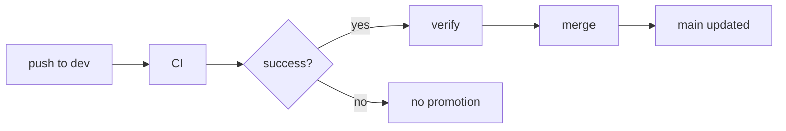

# Pipelines context

GitHub Actions, `cdMode: merge-only` (`.github/config.json` -> `pipelines`). Delivery means promoting code: a green CI run on `dev` is followed by a merge of that exact commit into `main`. Nothing is deployed, published, tagged or released.

## Workflows

| File | Name | Purpose |
| --- | --- | --- |
| `.github/workflows/ci.yml` | `CI` | Build and test Backend and Frontend, build both container images (no push) |
| `.github/workflows/cd.yml` | `CD` | Merge the CI-tested `dev` commit into `main` (`--no-ff`) |

## CI (`ci.yml`)

- Triggers: `push` to `dev`; `pull_request` into `dev` and `main`. Nothing else.
- `permissions: contents: read`; concurrency per workflow and ref, `cancel-in-progress: true`.
- Jobs (independent, no `continue-on-error`):

| Job | Steps |
| --- | --- |
| `backend` | in `Backend/`: `npm ci`, `npm run build`, `npm test` (Node 22.18, npm cache) |
| `frontend` | in `Frontend/`: `npm ci`, `npm run build`, `npm run test:ci` (Node 22.18, npm cache) |
| `containers` (matrix `Backend`, `Frontend`) | `docker build -f <Area>/Containerfile <Area>`, local tag only; no push, login, `--build-arg`, proxy |

- Only `actions/checkout@v4` (`persist-credentials: false`) and `actions/setup-node@v4`. No secrets.

## CD (`cd.yml`)

- Triggers: `workflow_run` of `CI` (`completed`, branch `dev`); `workflow_dispatch` (no inputs).
- Automatic run proceeds only if the CI run `conclusion == success`, `event == push` and `head_branch == dev` (PR runs and forks never promote).
- Workflow-level `permissions: contents: read`; concurrency group `cd-merge`, `cancel-in-progress: false`.

| Job | Permissions | What it does |
| --- | --- | --- |
| `verify` | `contents: read`, `actions: read` | Resolves the SHA: `workflow_run.head_sha`, or for a manual run the current head of `dev` (dispatch must be from `dev`) after confirming a successful `CI` push run exists for that SHA via the Actions API. Checks it is a 40-char SHA. |
| `merge` (`needs: verify`) | `contents: write` (only job) | Checks out `main` (full history), fetches `dev`, requires the SHA to be an ancestor of `origin/dev`, no-op if `main` already contains it, otherwise `git merge --no-ff <sha>`, then `git push origin HEAD:refs/heads/main`. |

- Merge commit message: `chore: merge dev into main (CI passed for <short-sha>)`; identity `github-actions[bot]`.
- Conflict: `git merge --abort`, job fails, nothing is pushed. Rejected push (main moved) fails the job; no force, no rebase, no reset, no retry.
- Push is by explicit refspec to `main` only: no other branch and no tag is written.
- Event data (SHA, ref, repository) reaches shell steps only through `env:`.
- The `merge` job keeps the checkout credentials persisted (it fetches and pushes with the built-in `GITHUB_TOKEN`); every other checkout in both workflows uses `persist-credentials: false`.
- Deliberately not done: deploy, image push, registry login, tags, releases, Pages, secrets other than `GITHUB_TOKEN`, third-party actions, PR creation.

## Repository settings the human must configure

Agents change none of these.

1. Push `dev` to `origin` (only `origin/main` exists remotely at the time of writing).
2. `workflow_run` runs only from the default branch: merge the change that adds `ci.yml` and `cd.yml` into `main` by hand once (until then CD cannot trigger automatically). Confirm `main` is the default branch.
3. Settings > Actions > General: Actions enabled; workflow permissions set to "Read and write" or otherwise not blocking the explicit `contents: write` of the `merge` job.
4. If `main` has branch protection or a ruleset (required PR, required checks, linear history): add `github-actions[bot]` (GitHub Actions app) to the bypass list, or CD's push is rejected. Merge commits must be allowed; "linear history" is incompatible with `--no-ff`. CD never works around protection; alternatively provide your own token secret (needs a spec change).
5. Optional: make the CI jobs required checks on PRs into `dev` and `main`, but not on the direct CD push to `main`.
6. Pushes made with `GITHUB_TOKEN` start no other workflows (acceptable: CI does not run on `main` pushes).

## Conventions

- Only `actions/*` actions at a major version tag; no `pull_request_target`.
- Every job has `timeout-minutes`.
- `contents: write` only on the CD `merge` job.
- CI changes that alter the workflow `name` must be mirrored in the `workflows:` list of `cd.yml`.

## Decisions and known gaps

- Frontend `ChromeHeadless` may need `--no-sandbox` on the runner; a follow-up `frontend` task would add a launcher.
- Docker Hub anonymous pull limits may occasionally fail the `containers` job.
- A bad commit that passes CI reaches `main` automatically (intended with `merge-only`).
- Manual dispatch lets anyone with write access promote the `dev` head (guarded by the CI-success check).
- Workflows were not run locally; `actionlint` and a YAML parser were unavailable. First real run is the validation.
