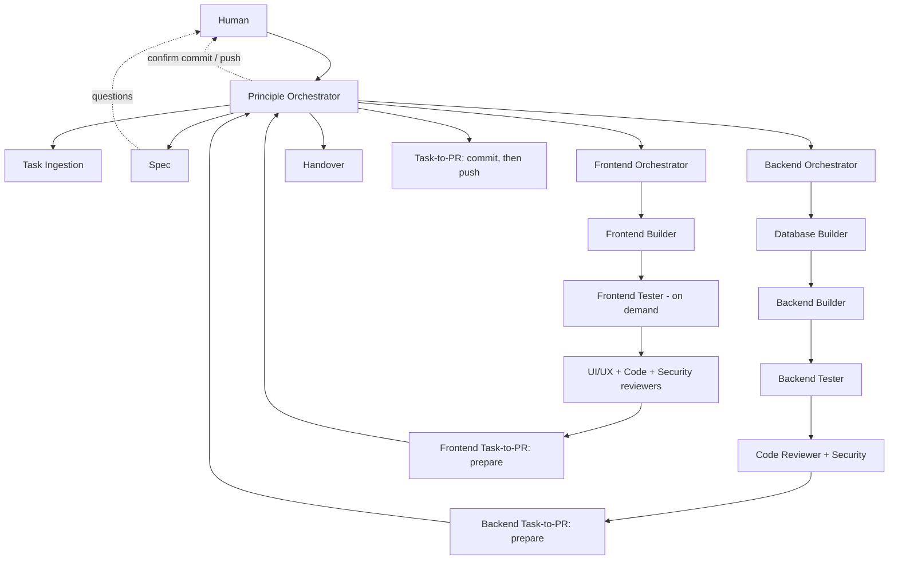

# Agent workflow

Entry point: `Principle Orchestrator` (or the `/start-workflow` prompt).

## Artifacts (all under `docs/`)

| Path | Written by |
| --- | --- |
| `tasks/<task-id>.md` | Task Ingestion (status updated by later agents) |
| `specs/<task-id>.md` | Spec |
| `runs/<task-id>/<step>.md` | Each builder/tester/reviewer, one report per step |
| `handover/<task-id>.md` | Handover |

## Configuration

`.github/config.json` -> `workflow`: `frontendTester` / `backendTester` accept `always` or `on-demand`; `backendSecurity` accepts `always`, `auto` or `on-demand`; `reviewers` is `auto` (the orchestrators pick only the reviewers the task needs, based on the spec `Scope flags`) or `all` (run every reviewer); `maxFixIterations` bounds the review-fix loop.

## Context files

`docs/context/` (`project.md`, `backend.md`, `frontend.md`) hold a compact, current map of the app so agents do not re-analyse the codebase per task. Builders update them at the end of each task and they are committed with the code; every other agent reads them first and opens only the files they point to. Protocol, freshness check and template: `docs/context/README.md`.

## Scope-based routing

- The spec chooses the smallest `Area`. A `frontend` task never calls any backend agent (orchestrator, builder, tester, reviewers, Task-to-PR) and vice versa.
- Each orchestrator selects reviewers from the spec `Scope flags` (`ui-changes`, `logic-changes`, `security-relevant`, `dependencies-changed`, `database-changes`, `scaffolding-only`) and reports every run/skip with a reason; `Handover` records it under `Review coverage`.

## Prerequisites

- VS Code setting `chat.subagents.allowInvocationsFromSubagents` = `true` (set in `.vscode/settings.json`); orchestrators call sub-agents from sub-agents.
- Start the `ado` server from the MCP view and enter the PAT when prompted (Azure tasks only).

## Task-to-PR

Runs after the reviewers, in three human-gated stages:

1. **prepare** (called by each orchestrator): no git changes; writes `runs/<task-id>/pr-<area>.md` and returns the proposed branch, commit message and file list.
2. **commit**: the principle orchestrator shows the proposals and asks the human to confirm; only then it calls the Task-to-PR agents with `mode: commit`, `human-confirmed: true` and the confirmed files. Both areas commit on one branch `feature/<task-id>-<title>`.
3. **push**: a separate confirmation; only then `push: true` pushes and opens one PR (`gh` or `az repos pr create`).

The workspace must be a git repository; otherwise the step is skipped. `Handover` runs after the commit step, so `docs/handover/` and the final task status are not part of the commits.
