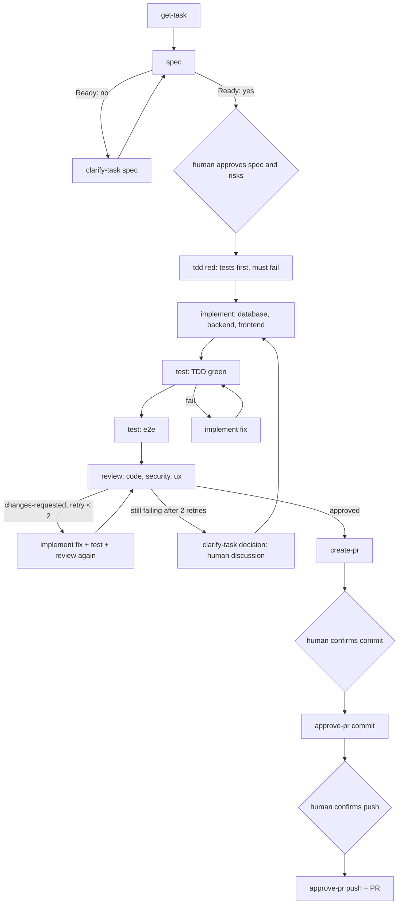

# Agent workflows

Three workflows, started by slash commands (skills in `.github/skills/`), run by 8 agents (`.github/agents/`). `Orchestrator` is the entry point and the only agent that talks to the human.

## Commands

| Command | Skill owner (agent) | Use |
| --- | --- | --- |
| `/start-task <id \| list \| text>` | Orchestrator | Run the standard workflow end to end |
| `/get-task <id \| list \| text>` | Task Analyst | Ingest a task from Azure DevOps or manual text |
| `/spec <id>` | Task Analyst | Write the spec, list questions |
| `/clarify-task <id> [spec \| decision]` | Orchestrator | Ask the human the spec questions, or a decision after a loop ran out |
| `/implement <id> <area>` | Implementer | Build frontend, backend or database; apply fixes |
| `/test <id> [tdd \| e2e \| all]` | Tester | TDD suite, then e2e (`tdd` is the inner skill) |
| `/review <id> [scope]` | Reviewer | Code, security, UX, containers, pipelines |
| `/create-pr <id>` | Release Manager | Prepare PR description, handover and commit proposal (no git changes) |
| `/approve-pr <id> [commit \| push]` | Release Manager | Commit, then push and open the PR (Azure DevOps or GitHub) |
| `/containerize [podman \| docker]` | Container Engineer | Containerization workflow |
| `/ci-cd [ci \| cd \| both]` | Pipeline Engineer | CI/CD workflow |

Each command can also be run on its own to resume or repeat one stage. `container-runtime` (Container Engineer) and `tdd` (Tester) are inner skills, not slash commands.

Every skill has the same layout: frontmatter (`name`, `description`, `argument-hint`, `user-invocable`), `# Get task`, `## Steps`, `## When it fails`, `## Never`.

## 1. Standard workflow (`/start-task`)

- The spec `Area` (`frontend`, `backend`, `containers`, `pipelines`) selects the stages; a `containers` or `pipelines` area runs workflow 2 or 3 as its implement stage.
- Test-first (`workflow.tddFirst`): before implementing a `frontend` or `backend` area the Tester writes the tests from the acceptance criteria (`/tdd <id> <area> red`); they must fail for the right reason (`Red baseline` in `tdd-<area>.md`). The Implementer makes them pass without editing them; `/test` then runs mode `green`, writes the tests deferred at red (they needed code that did not exist) and the fix loop applies.
- Test-fix loop: per failing test up to `maxTestFixLoops` (2) rounds (`implement fix` then `test rerun`); then human decision.
- Review retry: up to `maxFixIterations` (2) retries of implement -> test -> review for scopes with `blocker`/`high` findings; then human discussion. `medium`/`low` findings go to the PR.
- Reviewers are chosen from the spec `Scope flags` (`ui-changes`, `logic-changes`, `security-relevant`, `dependencies-changed`, `database-changes`, `scaffolding-only`); every run or skip is recorded under `Review coverage` in `pr.md`.

## 2. Containerization workflow (`/containerize`)

`get-task (manual) -> spec (area containers, risk gate) -> containerize -> review containers -> create-pr -> approve-pr`

`containerize` detects what exists and picks a mode: `create`, `verify` or `convert` (an existing Podman setup is converted to Docker and the other way round, shared files stay, only runtime-specific parts change; see `container-runtime`). It builds the files, applies the migrations to the local `db` container, starts the stack with one compose up, tests it (test-fix loop `maxTestFixLoops`), and has it reviewed (retries `maxFixIterations`). Design and decisions: `docs/context/containers.md`; settings: `.github/config.json` -> `containers`.

## 3. CI/CD workflow (`/ci-cd`)

`get-task (manual) -> spec (area pipelines) -> ci-cd (write ci.yml + cd.yml) -> security review of the workflows -> local validation -> create-pr -> approve-pr`

Generated CI (on push to `dev` and PRs): security check (`npm audit --omit=dev --audit-level=critical`) -> `npm run build` -> tests -> container build check (`push: false`). Generated CD: after CI succeeds on `dev`, merge the tested commit into `main` (`--no-ff`); nothing is deployed (`pipelines.cdMode: merge-only`). Design: `docs/context/pipelines.md`; settings: `.github/config.json` -> `pipelines`.

## Agents and skills

Per-agent context (tasks, defects and lessons, open items): `docs/agents/<agent>.md`. Every skill reads its agent's file first and the agent updates it as the last step of every task, so history is not re-derived from old reports (protocol: `docs/context/README.md`, Agent context files).

| Agent | Skills | Replaces |
| --- | --- | --- |
| Orchestrator | `start-task`, `clarify-task` | Principle, Frontend, Backend, Container, Pipeline orchestrators |
| Task Analyst | `get-task`, `spec` | Task Ingestion, Spec |
| Implementer | `implement` | Frontend, Backend, Database builders, Database Migrator |
| Tester | `tdd`, `test` | Frontend, Backend, Container testers |
| Reviewer | `review` | Frontend (code, security, UX), Backend (code, security), Container, Pipeline reviewers |
| Release Manager | `create-pr`, `approve-pr` | four Task-to-PR agents, Handover |
| Container Engineer | `containerize`, `container-runtime` | Container Builder |
| Pipeline Engineer | `ci-cd` | CI and CD Pipeline Builders |

## Artifacts (all under `docs/`)

| Path | Written by |
| --- | --- |
| `tasks/<task-id>.md` | `get-task` (status updated by later stages) |
| `specs/<task-id>.md` | `spec` |
| `runs/<task-id>/implement-<area>.md`, `tdd-<area>.md`, `e2e.md`, `review-<scope>.md`, `containerize.md`, `ci-cd.md` | one report per step, about 60 lines |
| `runs/<task-id>/pr.md`, `handover/<task-id>.md` | `create-pr` |

Task `status`: `new` -> `specified` -> `in-progress` -> `implemented` -> `done` (`approve-pr`).

## Configuration (`.github/config.json` -> `workflow`)

`tdd`: `always` or `on-demand`. `tddFirst`: `true` runs the red phase before implementing. `e2e`: `auto`, `always` or `off`. `security`: `always`, `auto` or `on-demand`. `reviewers`: `auto` (from the scope flags) or `all`. `maxFixIterations`: review retries. `maxTestFixLoops`: fix rounds per failing test.

## Human gates and risk gate

The Orchestrator asks the human: spec questions (`/clarify-task spec`), approval of the spec and of each risky item (`docs/risk-gate.md`), decisions after exhausted loops (`/clarify-task decision`), the commit confirmation and, separately, the push confirmation. Subagents cannot ask: they return `needs-human` or `needs-approval`. When a command is started directly by the human, the top-level chat asks. Agents never run SQL against anything except the local `db` container.

## Context files

`docs/context/` (`project.md`, `backend.md`, `frontend.md`, `containers.md`, `pipelines.md`) is the compact, current map of the app. `implement`, `containerize` and `ci-cd` update them; every other skill reads them first. Protocol: `docs/context/README.md`.

## Enforcement and checks

Skill text guides the model; these parts do not depend on it:
- `.github/hooks/guard.json` + `guard.cjs`: a `preToolUse` hook that denies shell commands the "Never" rules forbid (force-push, push of `main`/`master`, `--no-verify`, `git reset --hard`, branch deletion, `compose down -v`, prune/volume removal, Podman machine changes, `npm audit fix`, printing `.env`). It applies to every agent call, so if you really need one of them, run it yourself in a terminal. Agent hooks are a VS Code preview feature: check in `/hooks` that it is loaded.
- `node scripts/check-agents.mjs`: validates skill frontmatter and sections, agent definitions, `docs/agents/*.md` (sections, size, date), referenced files, `.github/config.json` keys, and warns on `done` tasks whose spec says otherwise. It runs as the `agents` job in CI.
- Still the human's to configure (agents must not): branch protection on `main`, workflow permissions, required checks, bot bypass (`docs/context/pipelines.md`).

## Prerequisites

- VS Code setting `chat.subagents.allowInvocationsFromSubagents` = `true` (in `.vscode/settings.json`).
- Start the `ado` MCP server and enter the PAT when prompted (Azure tasks only).
- The workspace must be a git repository for `/create-pr` and `/approve-pr`.
